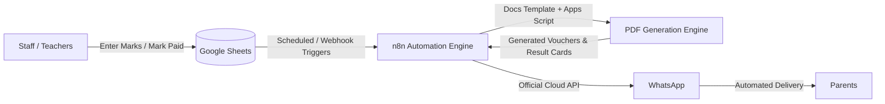

# School Automation Assistant (اسکول آٹومیشن اسسٹنٹ)

> **WhatsApp-First Automation for Small Private Schools, Academies & Tuition Centers**  
> *A lightweight, cost-effective automation system designed to eliminate manual administrative overhead, accelerate fee recovery, and streamline exam result delivery.*

---

## 📌 Executive Summary

Small private schools, tuition academies, and Hifz centers operate with lean teams and tight budgets. Today, most still manage their operations using physical paper registers, basic Excel sheets, and manual WhatsApp messaging.

**School Automation Assistant** automates repetitive administrative operations via a simple stack (**Google Sheets + n8n + WhatsApp Cloud API**). The rollout starts with two high-impact modules:
1. **Fee Recovery & Defaulter Follow-up** (Direct cash flow impact for owners)
2. **Automated Exam Result Card Generation** (Massive time-saver for teachers)

Once value is proven in the pilot phase, additional automations (attendance alerts, admissions follow-up, and paper checking) are gradually unlocked.

---

## ⚠️ Problems Faced by Small Schools

- **Delayed Fee Recovery**: Schools lack automated tracking; staff must manually identify defaulters and send reminders one by one.
- **Wasted Administrative Time**: School owners or headteachers spend 2–3 hours every day on calculations, reconciliations, and follow-ups.
- **Manual Result Preparation**: Teachers spend days handwriting report cards after exams—calculating totals, percentages, grades, and positions manually.
- **Teacher Burnout**: Low compensation paired with heavy clerical overhead leads to high teacher turnover.
- **Communication Gaps**: Parents often receive delayed updates regarding student attendance, exam results, and fee notices.
- **Lost Admission Inquiries**: Prospective student leads are not systematically tracked, resulting in lost enrollment opportunities.
- **Existing Software Is Incompatible**: Enterprise school management systems (ERP/LMS) are too expensive, bloated, and complicated for 100–500 student institutions.

---

## 💡 The Solution

An accessible, WhatsApp-first automation pipeline:
- **Fees**: Automated PDF fee voucher creation, scheduled pre-due and post-due reminders, ledger auto-updates, and automated defaulter tracking.
- **Exam Results**: Teachers simply enter subject marks into a protected sheet or form. The system automatically computes totals, percentages, letter grades, class ranks/positions, generates branded PDF report cards, and delivers them directly to parents via WhatsApp.
- **Future Expansions**: Absentee alerts, PTM notifications, admission inquiry follow-up, and AI-assisted paper evaluation.

---

## 🎯 Target Audience

- **Small Private Schools** (100 – 500 students)
- **Coaching & Tuition Academies** (Matric, FSc, O/A Levels)
- **Hifz & Quran Academies**
- **Competitive Coaching Centers** (MDCAT, ECAT, CSS, IELTS)

> **Buyer Persona**: The **School Owner / Principal** is the financial decision-maker. The core value proposition centers on:
> - Direct cash recovery (faster fee payments)
> - Hours saved for staff and teachers
> - Enhanced school reputation and parent satisfaction

---

## 🚀 Competitive Advantage & Market Positioning

| Aspect | Enterprise ERPs (e.g. StudentCare.pk) | DIY Registers & Excel | **School Automation Assistant** |
| :--- | :--- | :--- | :--- |
| **Parent App Required?** | Yes (often low adoption) | No | **No (Direct WhatsApp message)** |
| **Cost** | Expensive monthly/setup fees | Free | **Affordable subscription (Rs. 3k–10k/mo)** |
| **Complexity** | High (steep learning curve) | Manual / Error-prone | **Zero training needed (Google Sheets based)** |
| **Customizability** | Rigid corporate rules | Manual customization | **Tailored to each school's grading & rules** |
| **Focus** | Large payment rails (1BILL/Raast) | None | **Immediate fee recovery & communication** |

---

## 📋 Comprehensive Feature Matrix (11 Features)

| # | Feature | Build Difficulty | Value to Owner | Rollout Phase |
|---|---|---|---|---|
| **1** | **Fee Voucher + Reminders + Defaulter Report** | Easy | 🔥 Very High (Direct cash recovery) | **Phase 1 (MVP)** |
| **2** | **Result Cards (Marks $\rightarrow$ % $\rightarrow$ Grade $\rightarrow$ PDF $\rightarrow$ WhatsApp)** | Easy | 🔥 Very High (Saves teacher days) | **Phase 1 (MVP)** |
| **3** | **Absent / Attendance Alerts to Parents** | Easy | Medium | Phase 2 |
| **4** | **Announcements & PTM Reminders** | Very Easy | Low–Medium | Phase 2 |
| **5** | **Admission Inquiry Follow-up Workflow** | Medium | High (Increased enrollments) | Phase 2 |
| **6** | **MCQ Paper Checking Automation** | Medium | Medium | Phase 3 |
| **7** | **AI Subjective Paper Checking** | Hard | High (High risk, requires validation) | Phase 4 (Research) |
| **8** | **Teacher Attendance & Salary Sheet** | Medium | Medium | Phase 3 |
| **9** | **Owner Analytics Dashboard** | Medium | Medium–High | Active / In Progress |
| **10**| **Parents AI WhatsApp Chatbot** | Medium–Hard | Medium | Phase 4 |
| **11**| **Weak Student Performance Alerts** | Medium | Medium | Phase 3 |

---

## 🎯 Phase 1 Scope: What to Build First (and What to Defer)

### ✅ What We Build First (MVP)
1. **Fee Recovery Automation**: Demonstrates instant financial ROI (e.g., dropping fee default rates from 40% down to 15%), validating the monthly subscription.
2. **Automated Result Cards**: Easy to build (formulas + PDF template), high visual delight, and creates immediate teacher buy-in.

### ❌ What We Intentionally Defer (Post-Pilot)
- AI subjective (long answer) paper checking
- AI conversational chatbots for parents
- Custom user auth/login systems
- Direct online payment gateways / 1BILL / Raast integration
- Multi-tenant enterprise dashboard

---

## 🏗 System Architecture

### Architectural Layers

1. **Data Layer (Google Sheets)**:
   - `Students`: Student ID, Name, Class, Roll No, Father Name, Parent WhatsApp Number, Monthly Fee.
   - `Fees`: Student ID, Month, Due Date, Fee Amount, Status (`paid` / `pending` / `overdue`), Paid Date.
   - `Marks`: Student ID, Exam Type, Subject-wise Marks.
   - `Config`: School Name, Logo URL, Grade thresholds (A+, A, B, C, F, Pass marks). *Never hardcode grading rules.*
   - `Logs`: Message delivery timestamp, recipient, status, payload record.

2. **Logic & Automation (n8n)**:
   - Cron trigger runs daily morning checks.
   - Reads database rows from Google Sheets, filters overdue/upcoming fees, and routes jobs.
   - Anti-spam & de-duplication rules (prevents sending multiple reminders to the same parent on the same day).

3. **Document & PDF Generation Engine**:
   - Google Docs templates with dynamic placeholders (e.g. `{{name}}`, `{{total}}`, `{{grade}}`).
   - Converted to PDF using Google Apps Script / webhook services.

4. **Messaging Layer**:
   - Meta official **WhatsApp Cloud API** using approved utility message templates.

5. **Approval Workflow**:
   - Mandatory **"Preview $\rightarrow$ Approve"** gatekeeper mechanism before triggering mass result card dispatch to prevent sending inaccurate records to parents.

---

## 🗓 7-Day Implementation Plan (7 Din Ka Plan)

| Day | Milestone & Core Tasks | Deliverables |
| :---: | :--- | :--- |
| **Day 1** | **Setup & Foundation** • Setup Meta Business Manager & WhatsApp Cloud API. • Submit 3–4 official message templates (fee reminder, voucher, result announcement). • Design Google Sheets schema (`Students`, `Fees`, `Marks`, `Config`, `Logs`). | Configured Meta app & initial Google Sheet structure. |
| **Day 2** | **Fee Reminder Workflow** • Build n8n schedule trigger. • Filter: `Status == 'pending'` AND `DueDate <= Today + 2`. • Send test reminder messages to verified phone numbers. | Working fee reminder automation in n8n. |
| **Day 3** | **PDF Fee Voucher Engine** • Design Google Docs fee voucher template. • Connect Apps Script / PDF export webhook with n8n. • Send dynamic PDF vouchers via WhatsApp. | Automated PDF voucher creation & delivery. |
| **Day 4** | **Logging & Anti-Spam Safeguards** • Implement delivery logging into `Logs` sheet. • Add de-duplication logic (maximum 1 message/parent/day). • Auto-generate Defaulters Report sheet for owner review. | Resilient notification logic with spam protection. |
| **Day 5** | **Result Card Template & Calculation** • Write sheet formulas (total, percentage, grade lookup from `Config`, class position). • Design branded Result Card template in Google Docs. | Accurate grading calculations & report card template. |
| **Day 6** | **Batch Results Dispatch & Approval** • Add approval trigger ("Generate & Send" checkbox). • Batch PDF generation for the entire class. • End-to-end integration test with sample class data. | Full automated exam result generation pipeline. |
| **Day 7** | **Polish, Demo Video & Pitch Deck** • Record 2-minute concise product walkthrough video. • Fix edge cases and formatting glitches. • Prepare owner sales pitch script focused on ROI and time-saving. | Production demo & pitch kit ready for school pilots. |

---

## 🛡 WhatsApp API Considerations & Risk Management

1. **Template Approvals**:
   - Meta requires pre-approval for outbound notification templates. Submit utility templates on Day 1.
2. **Account Verification**:
   - Meta test numbers can only message registered test devices. Production pilots require official Business Verification and a dedicated school phone number.
3. **Ban Prevention**:
   - **Never** use unofficial scraping or QR-scan libraries (e.g., Baileys/Puppeteer) as they risk permanent number banning. Rely strictly on the official WhatsApp Cloud API.
4. **Development Fallback**:
   - If Meta template approvals take longer than expected, continue development through Days 2–6 using test numbers or email fallbacks so progress never blocks.
5. **Data Privacy**:
   - Student academic records and phone numbers are sensitive. Restrict Google Sheet permissions and ensure explicit parent opt-in.

---

## 💰 Business Model & Go-To-Market Next Steps

### Pricing Strategy
- **Monthly Retainer**: Rs. 3,000 to Rs. 10,000 / month (depending on student count).
- **Alternative Per-Student Model**: Small monthly charge per enrolled student (e.g. Rs. 20–30/student/month).
- **Pilot Strategy**: Offer the first 1–2 schools a free or subsidized 30-day pilot to capture testimonials, measure fee recovery percentage increase, and record time saved.

### Immediate Action Items
1. Interview 5–7 private school and coaching center owners to validate exact pain points.
2. Audit competitor offerings (e.g., StudentCare.pk) to identify gaps.
3. Complete the 7-day prototype.
4. Deploy in 1–2 pilot partner schools and gather case-study metrics.

---

*Repository maintained for Apex Academy & partner pilot institutions.*
